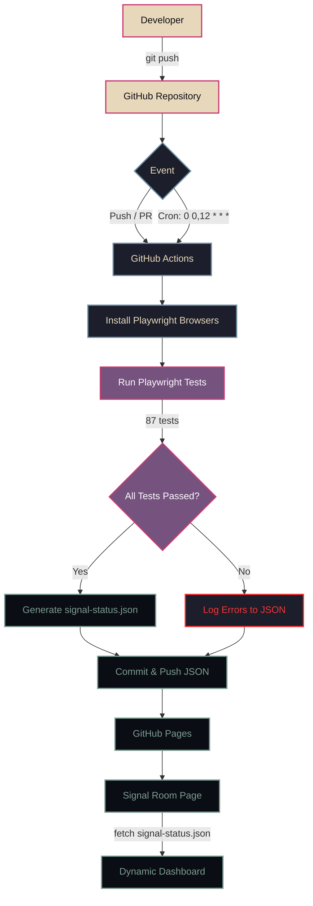

# RADIUS ARCHIVE — RADIUS TV ARCHIVE

An independent archival music project built around a fictional television center in the closed city of Radinsk (1976–1998). 

The project reconstructs lost recordings, broadcasts, and artifacts from a parallel history, presented through a dark, retro-futuristic web interface inspired by Soviet television, VHS aesthetics, and analog tape degradation.

> **Disclaimer:** A work of fiction. RADIUS ARCHIVE is an original archival reconstruction project. All characters, bands, institutes, and events are fictional.

## QA & Documentation
This project includes a full Software Testing Life Cycle (STLC) documentation:
- [Software Test Plan (STP)](docs/STP.md)
- [Software Test Description (STD)](docs/STD.md)
- [Software Test Report (STR)](docs/STR.md)

Automated tests are built with Playwright and run via GitHub Actions.

## Project Structure

- `index.html` / `ru/index.html` — Home page (hero, catalog, channels, manifesto)
- `projects.html` / `ru/projects.html` — Full catalog of musical projects with filters
- `archive-room-en.html` / `ru/archive-room.html` — Interactive Archive Room (CRT Monitor & Tape Monitor players)
- `signal-room-en.html` / `ru/signal-room.html` — Duty Shift dashboard, signal integrity log, and interference reports
- `about.html` / `ru/about.html` — Archive lore, timeline, and Formspark submission
- `404.html` / `ru/404.html` — Custom "Signal Lost" error page with CRT test card
- `[project-name].html` — Individual project pages (e.g., `605.html`, `phasezero.html`) with tracklists and streaming modals.
- `assets/css/styles.css` — Global design system (colors, typography, layout)
- `assets/js/main.js` — Core interactive logic (filters, modals, mobile menu, form submission, Easter Eggs)
- `assets/img/` — Cover art, banners, and the 404 TV test card.
- `tests/` — Playwright test suite (spec files and Page Objects).

## Tech Stack

- **Static HTML / CSS / JS** — No build step, no frameworks.
- **Typography:** Google Fonts (`Bebas Neue`, `Syne`, `JetBrains Mono`).
- **Responsive:** Mobile-first, fluid typography, adaptive grids.
- **Accessibility:** Semantic landmarks, `aria` attributes, focus states, skip-links.
- **Forms:** Integrated with [Formspark](https://formspark.io/) for archive submissions and bug reports.
- **Media:** YouTube IFrame Player API (CRT & Tape Monitor playback).

## Core Interactions

- **Archive Room:** 
  - **CRT Monitor:** Plays YouTube fragments with custom knobs. Optimized for mobile with `playsinline`.
  - **Tape Monitor:** Plays YouTube Music playlists on a reel-to-reel UI. A visible square player window (260x260px on desktop, 1:1 on mobile) centered between the reels.
- **Playlists & Modals:** Each project page features a streaming modal triggered by the "Listen on all platforms" button or the `?listen=1` deep link.
- **Filters:** The Projects page includes genre filtering with a "Show More" toggle.
- **Submissions (Optimistic UI):** Forms on About and Signal Room pages always show a success modal and reset, regardless of the API response. Real API status is logged to the console.
- **404 Error:** A custom 404 page styled as a malfunctioning Soviet television test card, complete with static noise and a return button.

## Customising

Design tokens (colors, fonts, spacing) are defined as CSS custom properties at the top of `assets/css/styles.css`. Update these variables to adjust the global theme.

## Testing & QA

The project is prepared for automated testing (Playwright). 
Key elements are marked with `data-testid` attributes to ensure stable selectors for QA automation.

**Test Coverage:**
- **Navigation:** Header links, language switcher, mobile menu.
- **Projects:** Filtering, statuses, and detail page modals.
- **Archive Room:** 10 test cases covering catalog loading, search, accordions, track/album clicks, and playback controls.
- **Forms:** Optimistic UI logic, modal closures (Escape, background, button).

**Cross-Browser:** All tests are configured to run on Chromium, Firefox, and WebKit.

**Note on API Limits:** Automated tests use Playwright's `page.route()` to mock Formspark and YouTube API responses. This prevents the test suite from consuming real monthly limits and ensures stable, fast execution.

## Easter Eggs

- **Console:** Open DevTools (F12) to see the RADIUS ARCHIVE system initialization log and the personnel dossier path.
- **Signal Room:** A hidden link (`SYSTEM OPERATOR ID: 7749`) in the dashboard leads to the developer's resume page.

**Note on Form Limits:** Automated tests must use Playwright's `page.route()` to mock Formspark API responses. This prevents the test suite from consuming the real monthly submission limit.

## Easter Eggs

- **Console:** Open DevTools (F12) to see the RADIUS ARCHIVE system initialization log and the personnel dossier path.
- **Signal Room:** A hidden link (`SYSTEM OPERATOR ID: 7749`) in the dashboard leads to the developer's resume page.

-----------------------------------------------------------

